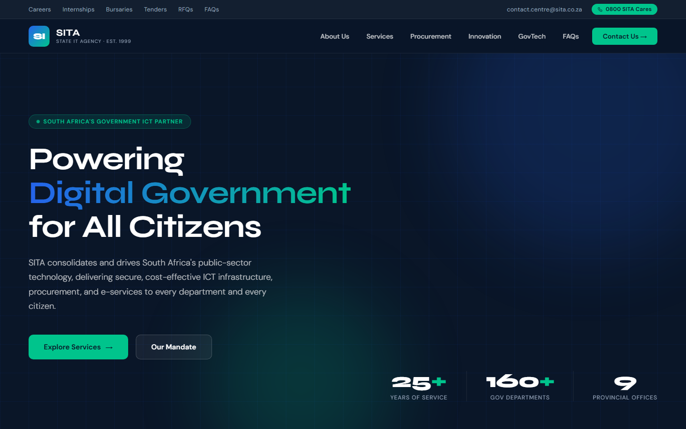
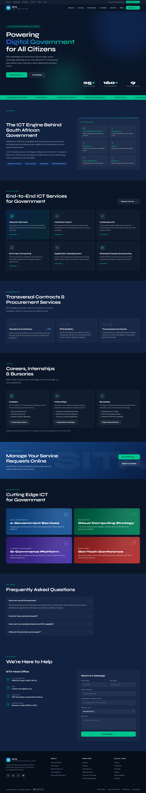
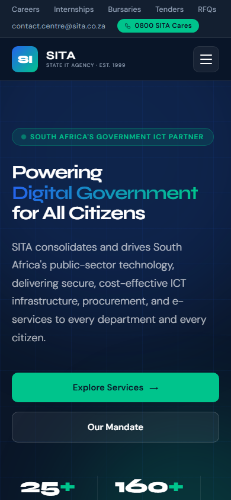

# SITA Website Redesign

A polished, fully working version of the SITA (State Information Technology Agency) redesign concept. It is a single self-contained file, `index.html`, with no build step. The only external resource is Google Fonts (Syne and DM Sans).

Open `index.html` in any browser to view it.

## Preview

### Desktop

Full desktop page

### Mobile

Full mobile page

## What was improved

**Everything now works**
- All 40+ placeholder `#` links were replaced. Topbar, nav and footer links jump to real sections, and contact details use `tel:` and `mailto:` links.
- New **Careers, Internships and Bursaries** section and a **FAQ** accordion, so the topbar and footer links have destinations.
- Service, procurement and innovation cards open the contact form with the enquiry type and a starter message already filled in.
- The contact form now has labels, validation, inline errors and a success message (demo only, nothing is sent).
- Social buttons link to the platforms and the map link opens the head office address.

**Responsive**
- The original had no mobile layout. It now has a hamburger menu (closes on link click and `Esc`), stacked grids, a scrollable topbar and hero stats that move below the content on narrower screens.

**Polish and accessibility**
- Emoji icons replaced with a crisp inline SVG icon set.
- Animated stat counters, scroll reveal, active section highlight in the nav, back to top button and a ticker that pauses on hover.
- Skip link, focus styles, ARIA labels and `prefers-reduced-motion` support.
- Fixed hero headline sizing so it no longer clips on small screens.
- All em dashes and en dashes removed from the copy and title.

The original fonts and colour palette were kept.

## Notes

- Footer links with no matching page on this site (Board of Directors, Annual Reports, Privacy Policy and similar) point to the official SITA website.
- Programme summaries in the opportunities section are illustrative.
